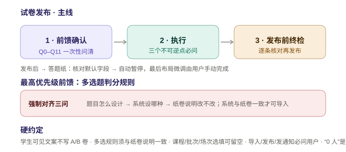

# exam-publish（试卷发布 Skill）

学习通（超星）**线下纸考/网评**考试，从试卷导入、组卷、给分规则、考试设置到发布与批阅设置的全流程 Skill。核心是四件事：**前馈确认**（该一开始问清的不能做到一半才发现）、**发布前终检**（拿单子逐条核对再发布）、**关键步骤必问**、**答题纸最后微调交用户**（核对默认字段后自动暂停，不自动改布局）。

## 主线



> 图源文件：[docs/workflow.svg](docs/workflow.svg)。

流程顺序：**建线下题库 → Word 智能导入组卷 → 分值与给分规则 → 考试设置 → 发布前终检 → 发布 → 通知 → 答题纸（核对默认字段 → 自动暂停，用户手动微调）→ 下载验证/批阅**。

## 最高优先级前馈：多选题判分规则

这是全链路错了代价最大、且发布后不可挽回的一项。凡涉及多选题，**先读 [`references/multi-choice-scoring.md`](references/multi-choice-scoring.md)**，完成"强制对齐三问"后才可导入：

1. **题目怎么设计？**（以纸质卷/参考答案实际文字为准）
2. **系统设哪种？**（全对才给 / 少选一半 / 指定比例 / 按选对数量，四种规则对照表见该文档）
3. **纸卷说明改不改？**（系统规则与纸卷不一致必须显式上报用户裁决，不许自行选一个）

导入前定规则，发布前终检单 C1/C2 再验一次——同一件事的两道关。

## 知识结构

| 文件 | 解决什么 |
|---|---|
| `SKILL.md` | 主入口：前馈→执行→终检→发布主线、铁律、决策树、与相邻 Skill 分工 |
| `references/multi-choice-scoring.md` | **最高优先级前馈**：多选四种规则 + 强制对齐三问 + 纸卷文案映射 |
| `references/feedforward-checklist.md` | Q0–Q10 前馈清单（系统形式、批阅模式、学生可见、发放班级、A/B卷文案、答题纸微调归属等） |
| `references/pre-publish-checklist.md` | 发布前逐条可勾选终检单 + 终检结论复述模板 |
| `references/execution-flow.md` | 执行顺序、三个不可逆提交点（加入试卷 / 发布 / 发通知）与答题纸人工暂停点 ④ |
| `references/review-modes.md` | 普通批 / 整卷批 / 流水批、多人监考、多人共教一门课的批阅分工 |
| `references/platform-pitfalls.md` | 平台踩坑：两套系统、`_lx1` 字段、UEditor 重置、显示假象、通知框同名歧义等 |

## 与相邻 Skill 的分工

- 本 Skill：流程顺序、前馈决策、终检、不可逆动作边界。
- [`chaoxing-ops`](https://github.com/Teaching-Works-Lab/chaoxing-ops)：具体控件怎么点才生效（`atomic-operations.md`）、线上/线下判定（P6）、77 张界面语义节点（`paper-exam/`）。
- [`exam-word-skill`](https://github.com/Teaching-Works-Lab/exam-word-skill)：Word 试卷/答题卡排版，以及纸质卷给分说明与系统规则的一致性校对。

业务决策（出什么题、给分规则怎么定）归属用户/教学设计文档；本 Skill 负责把这些决策变成发布前必须问清并核对的清单，安全落到平台。

## 运行环境

- 浏览器基于 **ego-browser**（`ego-browser nodejs <<'EOF'`），需保持教师端登录态；每次调用页面重置、ref 跨调用失效。
- 线下系统入口：`i.chaoxing.com/base?ws=1` → 考试/试卷/题库管理，域名 `v10596.kaoshi.chaoxing.com`。
- 智能导入会跳到 `mooc2-ans.chaoxing.com/.../qbank/smartimport` 再回跳线下 `zjSuccess`，属正常链路。

## 安装（WorkBuddy）

```bash
git clone https://github.com/Teaching-Works-Lab/exam-publish.git ~/.workbuddy/skills/exam-publish
```

Skill 由文件系统直接加载，clone/更新后无需重启，下次调用即读新内容。显式调用：`@skill:exam-publish`。

## 更新

```bash
git -C ~/.workbuddy/skills/exam-publish pull origin main
# 本地改完同步回 GitHub
git -C ~/.workbuddy/skills/exam-publish add -A
git -C ~/.workbuddy/skills/exam-publish commit -m "feat: ..."
git -C ~/.workbuddy/skills/exam-publish push origin main
```

维护约定：流程/前馈/终检问题补本 Skill 的 `references/`；控件级问题补到 `chaoxing-ops` 的原子手册。不把课程 ID、班级 ID、教师姓名、题号等一次性业务数据写进仓库。
